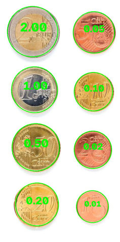
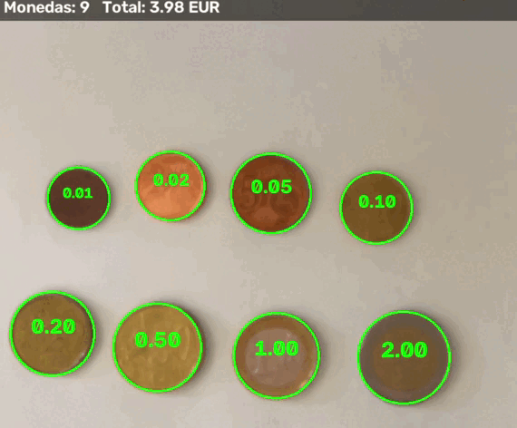
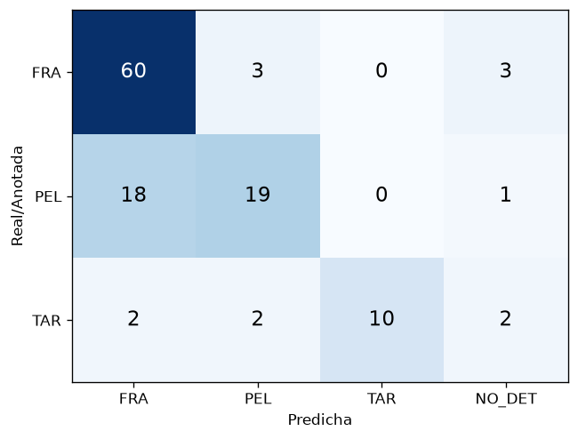
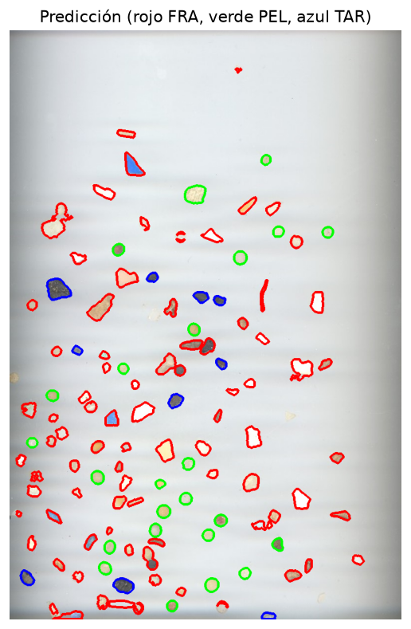

## Práctica 3. Monedas y microplásticos

**Autores:**  [Naiara Díaz Hernández](https://github.com/Naiara262005) y [Alejandro José Martel Torres](https://github.com/AlejandroMartel1)
### Contenidos

[Descripción del trabajo](#descripción-del-trabajo)  
[Tarea 1. Detección y valoración de monedas](#tarea-1-detección-y-valoración-de-monedas)  
[Tarea 2. Clasificación de microplásticos](#tarea-2-clasificación-de-microplásticos)  
[Fuentes y herramientas utilizadas](#fuentes-y-herramientas-utilizadas)

### Descripción del trabajo

El cuaderno entregado (*VC_P3_V4.ipynb*) contiene la resolución de las dos tareas propuestas en la práctica, sin emplear modelos de aprendizaje profundo, únicamente técnicas clásicas de visión por computador con OpenCV y NumPy.

- **Tarea 1:** detección de monedas de euro, calibración de la escala con una moneda de valor conocido, clasificación por color y diámetro, y demostrador interactivo con cámara en vivo.
- **Tarea 2:** segmentación de partículas de microplásticos, extracción de características geométricas y de color, clasificación en tres clases (FRA, PEL y TAR) y evaluación por partícula con métricas y matriz de confusión.

La primera tarea se prueba sobre la siguiente imagen:

  
    
  <em>Imagen sin modificar con una moneda de cada valor, desde 1 céntimo hasta 2 euros.</em>

                            

### Tarea 1. Detección y valoración de monedas

En esta primera tarea se ha desarrollado un sistema que detecta las monedas de una imagen y calcula su valor total. La idea central es que el clic del usuario sobre una moneda de valor conocido fija la escala (mm/píxel) como `diámetro real / diámetro en píxeles`; con esa escala, cada círculo se asigna a la moneda cuyo diámetro real es más cercano. Para realizarlo, se han aplicado las siguientes transformaciones:

1. Se convierte la imagen a grises y se suaviza con `cv2.medianBlur` (7), que conserva el borde exterior de la moneda de 1 € pero borra el relieve interno.
2. Se detectan los círculos con `cv2.HoughCircles` (`param1=90`, `param2=34`) y se descartan los que no tienen borde de Canny en al menos la mitad de su circunferencia (función `soporte_borde`), eliminando así falsos círculos.
3. Se afina cada círculo con `refinar_circulo`: se busca en cada dirección el borde más fuerte cerca del radio de Hough y se ajusta una circunferencia por mínimos cuadrados con descarte de *outliers*. Este paso es necesario porque el error de unos píxeles del radio de Hough ya confunde monedas de diámetro parecido.
4. Se eliminan los círculos contenidos dentro de otro de mayor radio.
5. Con el clic sobre una moneda de referencia se calcula la escala mm/píxel (`calibrar`).
6. Se clasifica el grupo de color de cada moneda en Lab (`detectar_grupo_color`) y se asigna el valor de entre las candidatas de su grupo con el diámetro más cercano.
7. Se pinta sobre la imagen cada círculo con su valor (verde si se reconoce, rojo con `?` si no) y se calcula el recuento por valor y el total.

**Clasificación por color y diámetro**

Los diámetros de varias monedas son muy próximos (1 € y 50 cts difieren en solo 1.1 mm), por lo que el diámetro por sí solo no basta. Por eso se divide el conjunto en cuatro grupos y el diámetro solo decide dentro de cada uno:

| Grupo | Monedas | Criterio |
|:---:|:---:|:---:|
| `cobre` | 1, 2 y 5 cts | tono rojizo: `A > 0.38·B` y `A > 4` en Lab |
| `oro` | 10, 20 y 50 cts | tono amarillo dominante en Lab |
| `1euro` | 1 € | corona más cromática que el núcleo (diferencia de croma > 6.5) |
| `2euro` | 2 € | núcleo más cromático que la corona (diferencia de croma < -6.5) |

Las monedas bimetálicas se detectan comparando el croma (distancia al gris neutro en los canales A y B de Lab) de un disco central con el de una corona exterior. Si el diámetro medido queda a más de 1.8 mm de la moneda más cercana de su grupo, se hace una comprobación general con todas las monedas (admitiéndola solo si la diferencia es de 1.0 mm o menos) y, si tampoco encaja, o el diámetro queda fuera de 14.5-27.5 mm, se marca como `?` (objeto que no es moneda).

**Resultado sobre imagen estática**

Tras calibrar con la moneda de 1 € (escala de 0.1260 mm/px), se reconocen las 8 monedas sin descartar ningún círculo, con un total de 3.88 €, que coincide con el valor real de las monedas de la imagen.

  
   
  <em>Resultado sobre la imagen estática: cada moneda aparece rodeada en verde con el valor asignado.</em>

**Demostrador en vivo**

Sobre la misma base se ha creado un demostrador interactivo con cámara, usando un iPhone como webcam mediante DroidCam. Para que la clasificación sea estable entre fotogramas se han añadido las siguientes mejoras:

| Técnica | Uso en el demostrador |
|:---:|:---:|
| Emparejamiento por proximidad de círculos (*tracks*) | identificar la misma moneda entre fotogramas consecutivos |
| Media móvil de posición (0.6/0.4) y radio (0.75/0.25) | evitar el temblor de los círculos |
| Media móvil exponencial del color (`ALPHA_COLOR = 0.2`) | estabilizar la medida de croma frente al ruido de la cámara |
| Histéresis (6.5 de entrada, 3.5 de salida) | evitar que una moneda bimetálica cambie de grupo por pequeñas oscilaciones |
| Máscaras de núcleo (≤ 0.45·r) y corona (0.78-0.92·r) | separar mejor ambos metales, ya que la frontera real está cerca de 0.7·r |
| Banner semitransparente | mostrar el recuento y el total sin que se superponga con las monedas |

Las teclas del demostrador son: `1` = referencia de 1 €, `2` = 2 €, `5` = 50 cts y `0` = 10 cts (se elige antes de hacer clic), clic sobre la moneda para calibrar, `r` para borrar la calibración y ESC para salir. Si se mueve la cámara cambia la escala y es necesario volver a calibrar.

  
   
  <em>Demostración del contador de monedas en vivo, calibrando con una moneda de 1 €.</em>

**Problemas observados**

- **Iluminación, reflejos y sombras:** la clasificación depende del croma, por lo que los reflejos fuertes y el autoajuste de exposición y balance de blancos de la cámara alteran el color percibido, sobre todo en las bimetálicas, que eran las que más oscilaban antes de introducir el seguimiento temporal y la histéresis.
- **Cámara inclinada o a distinta distancia:** la escala solo es válida para el plano y la distancia en la que se calibró; si se mueve la cámara hay que volver a pulsar `r` y calibrar.
- **Monedas de diámetro parecido (20 cts / 1 € / 50 cts):** al fallar la detección bimetálica, el 1 € pasa al grupo `oro` y se confunde con la de 50 cts (1.1 mm de diferencia). La comprobación por color, el refinado del radio y la histéresis reducen este problema.
- **Objetos que no son monedas y solapes:** se descartan por falta de soporte de borde, por quedar fuera del rango de diámetros o por quedar contenidos en otro círculo; las monedas solapadas pueden perderse.

### Tarea 2. Clasificación de microplásticos

En esta segunda tarea se clasifican partículas de microplásticos en tres clases: fragmentos (**FRA**), pellets (**PEL**) y alquitrán (**TAR**). El flujo es: segmentar, extraer las características de cada partícula, aprender un clasificador usando solo las imágenes de entrenamiento y evaluarlo por partícula sobre `MPs_test.jpg` con las anotaciones de `MPs_test_bbs.csv`. Para realizarlo, se han aplicado las siguientes transformaciones:

1. Se calcula la diferencia de color en Lab de cada píxel respecto a un fondo local, estimado con una mediana de gran tamaño sobre la imagen reducida y con borde reflejado. Así se corrigen las bandas y el viñeteo del escáner.
2. Se atenúa el borde oscuro del escáner en lugar de recortarlo, para no perder partículas pegadas al borde.
3. Se umbraliza con histéresis: el umbral alto se adapta al ruido de cada imagen (`max(15, 7·mediana)`) y el bajo es 2/3 del alto; solo se conservan las componentes conexas que contienen algún píxel por encima del umbral alto.
4. Se limpia la máscara con una apertura (2×2) y un cierre elíptico (3×3), se extraen los contornos con `cv2.findContours` y se descartan los de área menor a 20 píxeles o desproporcionadamente grandes.
5. Se calculan 13 características por contorno, pensadas para ser independientes de la escala y de la iluminación.
6. Se estandarizan de forma robusta (mediana y MAD) y se clasifica cada partícula con un kNN (k = 7) ponderado por 1/distancia y equilibrado por clase, de modo que una clase más abundante en el entrenamiento no gane solo por su tamaño.
7. Se empareja cada anotación con el contorno cuyo centroide cae dentro de su caja (el de mayor área) y se calculan las métricas.

**Características utilizadas**

| Tipo | Características |
|:---:|:---:|
| Geométricas | `area`, `compacidad`, `extent`, `aspecto`, `elipse`, `dist`, `solidez`, `circ` |
| Luminosidad | `L_rel` (respecto al fondo), `L_std` (textura), `oscuro` (fracción de píxeles muy oscuros) |
| Color | `croma` (Lab), `sat` (HSV) |

**Entrenamiento**

Se usa una imagen por clase, recortada para excluir los bordes del escáner y reducida con un factor de 0.4, de las que se extraen 69 partículas FRA, 54 PEL y 54 TAR. Las características que más separan las clases son las de color y luminosidad: el alquitrán es mucho más oscuro respecto al fondo, más rugoso y casi sin color, y los pellets son los más compactos y circulares.

| Clase | `L_rel` | `L_std` | `croma` | `circ` | `oscuro` |
|:---:|:---:|:---:|:---:|:---:|:---:|
| FRA | -36.64 | 11.13 | 10.89 | 0.54 | 0.18 |
| PEL | -51.14 | 12.76 | 12.11 | 0.79 | 0.26 |
| TAR | -91.30 | 35.00 | 1.62 | 0.69 | 0.78 |

El acierto en entrenamiento con validación *leave-one-out* es de 0.864.

**Resultado sobre la imagen de test**

La imagen de test tiene 120 partículas anotadas; la segmentación encuentra 117 contornos, de los cuales 6 anotaciones quedan sin detectar y 4 contornos no corresponden a ninguna anotación. El acierto global es de 0.742.

| Clase | Precisión | Recall | F1 | n |
|:---:|:---:|:---:|:---:|:---:|
| FRA | 0.75 | 0.91 | 0.82 | 66 |
| PEL | 0.79 | 0.50 | 0.61 | 38 |
| TAR | 1.00 | 0.62 | 0.77 | 16 |

  
   
  <em>Matriz de confusión por partícula (filas: clase anotada, columnas: clase predicha, incluyendo la columna NO_DET para partículas no segmentadas).</em>

  
   
  <em>Contorno de cada partícula coloreado por la clase predicha (rojo FRA, verde PEL, azul TAR).</em>

**Problemas observados**

- **Partículas pegadas que la segmentación une en un solo contorno:** el número de contornos (117) es menor que el de anotaciones (120) y hay contornos de área elevada (hasta 1886 píxeles, frente a la mediana de unos 676 de las cajas anotadas) que probablemente son varias partículas unidas, lo que distorsiona sus características geométricas.
- **Clase que más se confunde y por qué:** los pellets (recall 0.50) son la clase peor reconocida y la mayoría de sus errores se reparten hacia fragmentos, que tienen precisión de 0.75 y absorben partículas de otras clases. El alquitrán, por el contrario, tiene precisión de 1.00: cuando se predice TAR no falla, pero se pierde parte de las partículas (recall 0.62), en parte por las no detectadas.
- **Diferencias entre entrenamiento y test:** las imágenes de entrenamiento (3456×4608, reducidas con factor 0.4) y la de test (1186×790) tienen distinta resolución e iluminación, y solo se dispone de una imagen de entrenamiento por clase, lo que explica la bajada de acierto desde el 0.864 del entrenamiento hasta el 0.742 del test.

### Fuentes y herramientas utilizadas

- Enunciado y cuaderno base de la práctica 3, Visión por Computador, ULPGC. Las imágenes de monedas y de microplásticos, así como las anotaciones `MPs_test_bbs.csv`, son las proporcionadas en la práctica.
- Se utilizó DroidCam para emplear un iPhone como cámara en el demostrador en vivo.
- Se utilizó Claude en algunos momentos para depurar el uso de la cámara virtual, estabilizar la clasificación de las monedas bimetálicas y redactar el README.

****
- [Hough Circle Transform](https://docs.opencv.org/4.x/da/d53/tutorial_py_houghcircles.html)
- [Canny Edge Detection](https://docs.opencv.org/4.x/da/d22/tutorial_py_canny.html)
- [Contour Features](https://docs.opencv.org/4.x/d1/d32/tutorial_py_contour_properties.html)
- [Changing Colorspaces](https://docs.opencv.org/4.x/df/d9d/tutorial_py_colorspaces.html)
- [Matplotlib](https://matplotlib.org)
